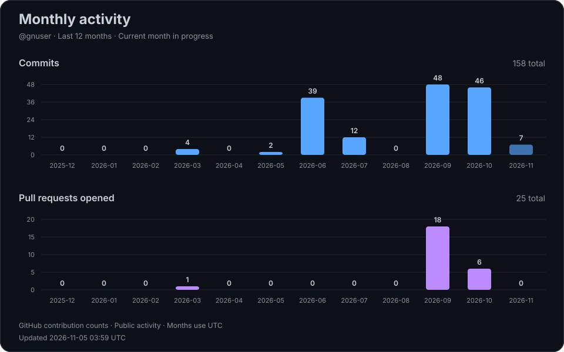

# Hi, I'm gnuser 👋

Monthly GitHub activity from selected public projects over the last 12 months, updated daily. The current month is still in progress.

Private repositories are excluded. Commits follow GitHub contribution rules; pull requests count when opened. Months use UTC. Each chart has its own scale.

[View monthly data](assets/monthly-activity.json) · [Update workflow](../../actions/workflows/update-chart.yml)
